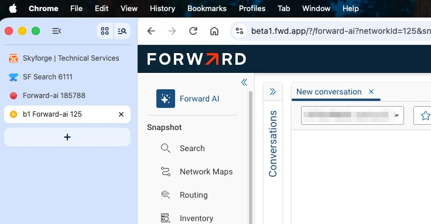

# Custom Tab Titles & Favicons

When you have lots of Forward tabs open in a browser, they all look the same.  When you have so many that the words disappear, only the Favicon remains. This leaves you clicking between tabs to find where you were a few minutes ago.

This is a small Chrome extension that sets a custom tab title and favicon for various Forward sites, based on hostname and path/query rules. Currently configured for:

- `fwd.app/docs/*` → "FwdDocs"
- `fwd.app/?/*` → "FwdApp"
- `scaling700.ext.forwardnetworks.com` → "S700"
- `beta1.fwd.app` → "b1"

The result looks like this.  The format of the tab text is 
- a short reference to denote the site (e.g. b1 for beta1, SF for SkyForge)
- the name of the app you are using on that site (e.g. forward-ai)
- the network-id (e.g. 125)




## Folder structure

```
tab-customizer/
├── manifest.json
├── content.js
├── icons/
│   ├── icons8-red-dot-32.png
│   └── icons8-blue-dot-32.png
```

## Installation

1. Go to `chrome://extensions`
2. Enable **Developer mode** (top right toggle)
3. Click **Load unpacked**
4. Select the `tab-customizer` folder

## Updating rules

Rules live in `content.js` in the `rules` array. Each rule needs:

- `test()` — a function returning `true`/`false` based on `host`, `path`, and `query`
- `title` — the tab title to apply
- `icon` — path to the icon file (must live under `icons/`)

Rules are checked in order; the first match wins.

```javascript
{
  test: () => host === "example.com" && path.startsWith("/app"),
  title: "My Title",
  icon: "icons/my-icon.png"
}
```

## Adding a new site

1. Add the new URL pattern to **both** `matches` arrays in `manifest.json` (under `content_scripts` and `web_accessible_resources`).
2. Add a new rule to the `rules` array in `content.js`.
3. Drop the icon file into `icons/`.
4. Reload the extension from `chrome://extensions` (click the refresh icon on the extension card or disable and re-enable it)

## Notes

- Icons should be small (16x16 or 32x32 PNGs work well). 
- You can add your own icons if you want.   At this size you can get free ones from https://icons8.com/
- Icons of different size will fail to display.